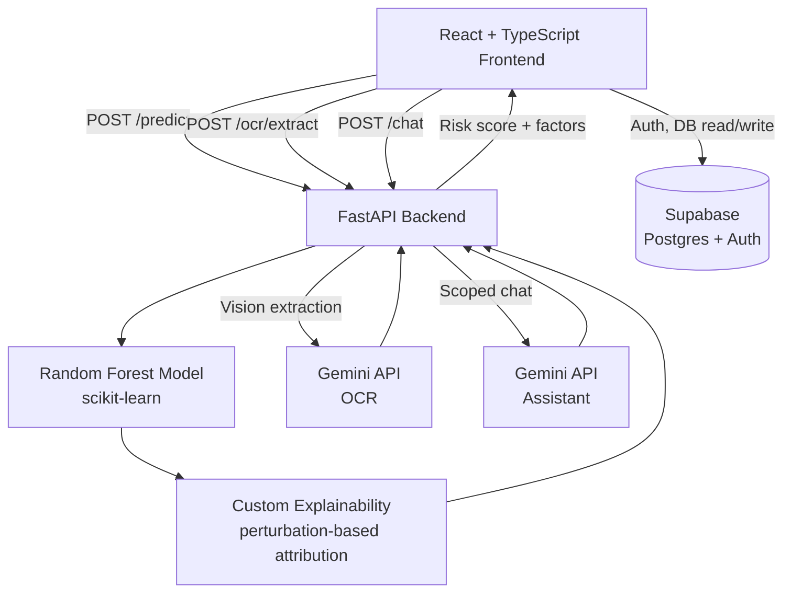
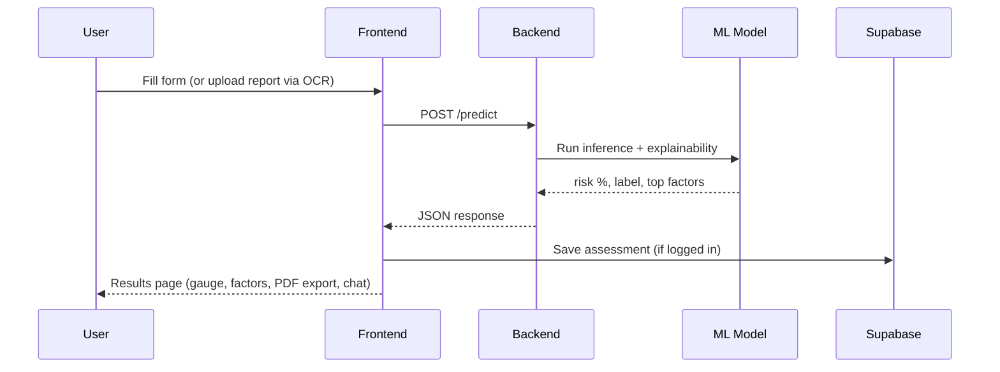

<div align="center">


<p align="center">
  <b>Estimate cardiovascular risk from a clinical assessment or a lab report — with a plain-language explanation, not just a number.</b>
</p>

<br/>

<p align="center">
  
  
  
</p>

<p align="center">
  <a href="#-features"></a>
  <a href="#-getting-started"></a>
  <a href="#-api-reference"></a>
  <a href="https://github.com/zehranisar/CardioScan.ai/issues"></a>
  <a href="https://github.com/zehranisar/CardioScan.ai/issues"></a>
</p>

<br/>

<p align="center">
  
  
  
  
  <br/>
  
  
  
  
  <br/>
  
  
  
  
</p>

</div>

<br/>

> ⚠️ **Not a medical device.** This is a portfolio and academic project. Predictions are statistical estimates from a model trained on a public research dataset — not a clinical diagnosis. Always consult a doctor for real health decisions.

<br/>

## 📋 Table of contents

- [✨ Features](#-features)
- [🧠 Architecture](#-architecture)
- [🛠️ Tech stack](#️-tech-stack)
- [📁 Project structure](#-project-structure)
- [🚀 Getting started](#-getting-started)
- [🔌 API reference](#-api-reference)
- [📊 Model performance](#-model-performance)
- [🗺️ Status](#️-status)
- [👤 Author](#-author)

<br/>

## ✨ Features

<table>
<tr>
<td width="50%" valign="top">

**🩺 Assessment & prediction**
- Multi-step form covering 13 clinical markers
- Random Forest classifier — **83.6% accuracy / 0.915 ROC-AUC**
- Custom perturbation-based explainability — no black-box output
- PDF report export, ready to bring to a doctor

</td>
<td width="50%" valign="top">

**🤖 AI integration**
- OCR auto-fill — photograph a lab report or ECG printout and let Gemini Vision read it
- Scoped Gemini assistant — answers heart-health questions only, with full context of your result

</td>
</tr>
<tr>
<td width="50%" valign="top">

**🔐 Accounts & data**
- Full auth: sign up, sign in, email OTP, forgot/reset password
- Entire app is auth-gated — nothing is visible without an account
- Row-Level-Security-protected history, stored in Supabase

</td>
<td width="50%" valign="top">

**📈 Dashboard**
- Full assessment history with a risk-over-time trend chart
- Side-by-side comparison of any two assessments
- Delete individual records
- Fully responsive, down to mobile widths

</td>
</tr>
</table>

<div align="right"><a href="#-table-of-contents">↑ back to top</a></div>

<br/>

## 🧠 Architecture



**Assessment flow:**



<div align="right"><a href="#-table-of-contents">↑ back to top</a></div>

<br/>

## 🛠️ Tech stack

| Layer | Technology |
|---|---|
| Frontend | React, TypeScript, Vite, Tailwind CSS, React Router |
| Backend | FastAPI (Python) |
| Machine learning | scikit-learn (Random Forest), pandas, numpy |
| Explainability | Custom perturbation-based feature attribution |
| AI integration | Google Gemini API — vision extraction (OCR) and scoped chat |
| Auth & database | Supabase (PostgreSQL + Auth, Row Level Security) |
| Email delivery | Brevo (SMTP) |
| PDF generation | jsPDF (client-side) |
| Charts | Recharts |

<div align="right"><a href="#-table-of-contents">↑ back to top</a></div>

<br/>

## 📁 Project structure

```
CardioScan.ai/
├── frontend/
│   ├── src/
│   │   ├── components/     # Navbar, ChatPanel, ReportUpload, modals, etc.
│   │   ├── pages/           # Landing, Assessment, Results, Dashboard, Auth pages
│   │   ├── context/         # AuthContext
│   │   └── lib/              # API clients, Supabase client, PDF generator
│   └── package.json
├── backend/
│   ├── app/
│   │   ├── ml/                # train.py, predict.py, model.pkl, dataset
│   │   ├── ocr/               # Gemini Vision extraction logic
│   │   ├── chat/              # Gemini chat logic with scoped system prompt
│   │   ├── routers/          # /predict, /ocr/extract, /chat endpoints
│   │   └── schemas/          # Pydantic request/response models
│   ├── main.py
│   ├── requirements.txt
│   └── supabase_migration.sql
└── README.md
```

<div align="right"><a href="#-table-of-contents">↑ back to top</a></div>

<br/>

## 🚀 Getting started

### Prerequisites
- Node.js 18+
- Python 3.11+
- A [Supabase](https://supabase.com) project
- A [Google Gemini API key](https://aistudio.google.com/apikey)

### Backend setup

```bash
cd backend
pip install -r requirements.txt
```

Create a `.env` file in `backend/`:
```env
GEMINI_API_KEY=your_gemini_api_key
```

Train the model (already included, but re-runnable):
```bash
python -m app.ml.train
```

Start the server:
```bash
uvicorn main:app --reload --port 8000
```

### Frontend setup

```bash
cd frontend
npm install
```

Create a `.env` file in `frontend/`:
```env
VITE_API_URL=http://localhost:8000
VITE_SUPABASE_URL=your_supabase_project_url
VITE_SUPABASE_ANON_KEY=your_supabase_publishable_key
```

Run `backend/supabase_migration.sql` via the Supabase SQL Editor to create the `assessments` table.

Start the dev server:
```bash
npm run dev
```

<div align="right"><a href="#-table-of-contents">↑ back to top</a></div>

<br/>

## 🔌 API reference

| Endpoint | Method | Description |
|---|---|---|
| `/predict` | `POST` | Takes 13 clinical inputs, returns risk probability, label, and top contributing factors |
| `/ocr/extract` | `POST` | Accepts an image/PDF of a lab report, returns extracted clinical values |
| `/chat` | `POST` | Sends a message (with optional result context) to the scoped health assistant |
| `/health` | `GET` | Health check |

<div align="right"><a href="#-table-of-contents">↑ back to top</a></div>

<br/>

## 📊 Model performance

Trained on the UCI Cleveland Heart Disease dataset (303 samples, 13 features):

<div align="center">

| Metric | Score |
|:---:|:---:|
| **Accuracy** | 83.6% |
| **ROC-AUC** | 0.915 |

</div>

<div align="right"><a href="#-table-of-contents">↑ back to top</a></div>

<br/>

## 🗺️ Status

- ✅ Core prediction pipeline, explainability, OCR, and chatbot
- ✅ Authentication, dashboard, PDF export
- ⏳ Production deployment — in progress

<div align="right"><a href="#-table-of-contents">↑ back to top</a></div>

<br/>

## 👤 Author

<div align="center">

**Zehra Nisar**
Computer Science student & full-stack developer

<a href="https://github.com/zehranisar"></a>

</div>

<br/>

<div align="center">

*This project is for academic and portfolio purposes.*

</div>
