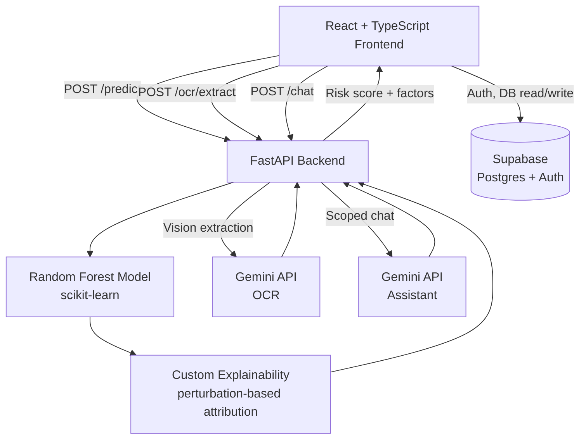
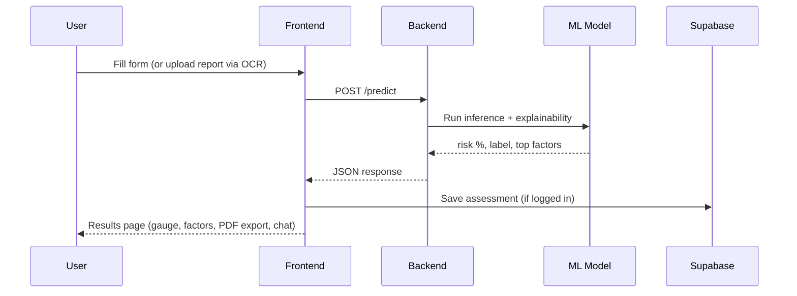

# CardioScan.ai

**AI-powered heart disease risk assessment — with an explanation, not just a number.**

CardioScan.ai estimates cardiovascular risk from a short clinical assessment or an uploaded lab report, then explains exactly which factors drove the result. Built as a full-stack academic/portfolio project combining classical machine learning, explainable AI, computer vision, and a scoped conversational assistant.

> ⚠️ This is a portfolio and academic project. Predictions are statistical estimates from a model trained on a public research dataset — not a medical diagnosis. Always consult a doctor for real health decisions.

---

## ✨ Features

- **Multi-step risk assessment** — 13 clinical markers (age, blood pressure, cholesterol, ECG results, and more), based on the UCI Cleveland Heart Disease dataset
- **ML-based prediction** — Random Forest classifier, **83.6% accuracy / 0.915 ROC-AUC**
- **Explainability** — a custom perturbation-based attribution method shows exactly which factors increased or decreased each result, with no black-box output
- **OCR auto-fill** — upload a photo of a lab report or ECG printout; Google Gemini Vision reads it and pre-fills the assessment form
- **Scoped AI assistant** — a Gemini-powered chatbot that only answers cardiovascular health questions, with full context of the user's own result
- **Full authentication** — sign up, sign in, email OTP verification, forgot/reset password, and sign-out confirmation, via Supabase
- **Dashboard** — assessment history, a risk-over-time trend chart, side-by-side comparison of any two assessments, and delete support
- **PDF report export** — download a clean, doctor-ready summary of any result
- **Auth-gated** — the entire app requires an account; nothing is accessible without signing in
- **Fully responsive** — tested down to mobile widths

---

## 🧠 Architecture



**Assessment flow:**



---

## 🛠️ Tech stack

| Layer | Technology |
|---|---|
| Frontend | React, TypeScript, Vite, Tailwind CSS, React Router |
| Backend | FastAPI (Python) |
| Machine learning | scikit-learn (Random Forest), pandas, numpy |
| Explainability | Custom perturbation-based feature attribution |
| AI integration | Google Gemini API — vision extraction (OCR) and scoped chat |
| Auth & database | Supabase (PostgreSQL + Auth, Row Level Security) |
| Email delivery | Brevo (SMTP) |
| PDF generation | jsPDF (client-side) |
| Charts | Recharts |

---

## 📁 Project structure

```
CardioScan.ai/
├── frontend/
│   ├── src/
│   │   ├── components/     # Navbar, ChatPanel, ReportUpload, modals, etc.
│   │   ├── pages/           # Landing, Assessment, Results, Dashboard, Auth pages
│   │   ├── context/         # AuthContext
│   │   └── lib/              # API clients, Supabase client, PDF generator
│   └── package.json
├── backend/
│   ├── app/
│   │   ├── ml/                # train.py, predict.py, model.pkl, dataset
│   │   ├── ocr/               # Gemini Vision extraction logic
│   │   ├── chat/              # Gemini chat logic with scoped system prompt
│   │   ├── routers/          # /predict, /ocr/extract, /chat endpoints
│   │   └── schemas/          # Pydantic request/response models
│   ├── main.py
│   ├── requirements.txt
│   └── supabase_migration.sql
└── README.md
```

---

## 🚀 Getting started

### Prerequisites
- Node.js 18+
- Python 3.11+
- A [Supabase](https://supabase.com) project
- A [Google Gemini API key](https://aistudio.google.com/apikey)

### Backend setup

```bash
cd backend
pip install -r requirements.txt
```

Create a `.env` file in `backend/`:
```
GEMINI_API_KEY=your_gemini_api_key
```

Run the training script once to generate the model (already included, but re-runnable):
```bash
python -m app.ml.train
```

Start the server:
```bash
uvicorn main:app --reload --port 8000
```

### Frontend setup

```bash
cd frontend
npm install
```

Create a `.env` file in `frontend/`:
```
VITE_API_URL=http://localhost:8000
VITE_SUPABASE_URL=your_supabase_project_url
VITE_SUPABASE_ANON_KEY=your_supabase_publishable_key
```

Run the `supabase_migration.sql` script (in `backend/`) via the Supabase SQL Editor to create the `assessments` table.

Start the dev server:
```bash
npm run dev
```

---

## 🔌 API reference

| Endpoint | Method | Description |
|---|---|---|
| `/predict` | POST | Takes 13 clinical inputs, returns risk probability, label, and top contributing factors |
| `/ocr/extract` | POST | Accepts an image/PDF of a lab report, returns extracted clinical values |
| `/chat` | POST | Sends a message (with optional result context) to the scoped health assistant |
| `/health` | GET | Health check |

---

## 📊 Model performance

Trained on the UCI Cleveland Heart Disease dataset (303 samples, 13 features):

| Metric | Score |
|---|---|
| Accuracy | 83.6% |
| ROC-AUC | 0.915 |

---

## 🗺️ Status

- ✅ Core prediction pipeline, explainability, OCR, and chatbot — complete
- ✅ Authentication, dashboard, PDF export — complete
- ⏳ Production deployment — pending

---

## 👤 Author

**Zehra Nisar**
Computer Science student, full-stack developer

---

## 📄 License

This project is for academic and portfolio purposes.
